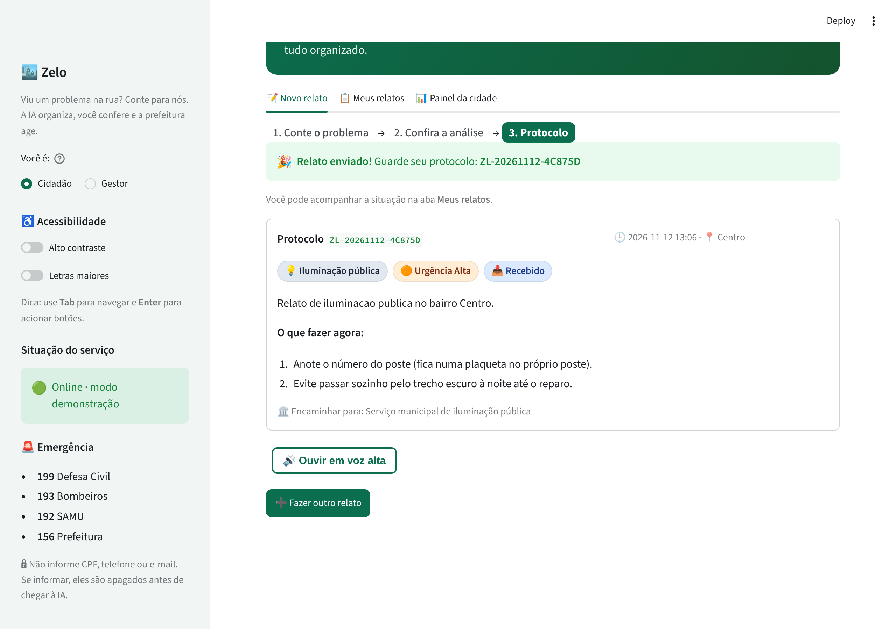
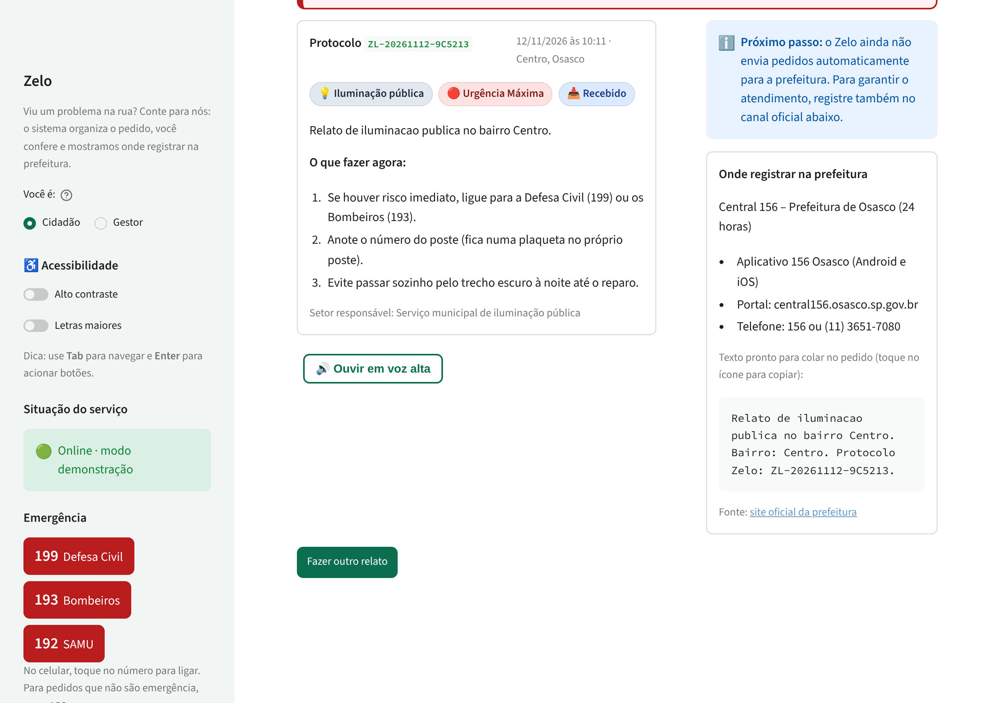
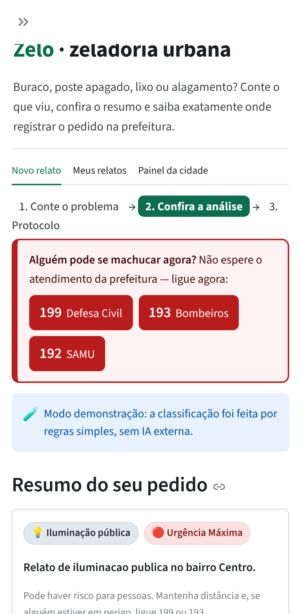

# Validação com pessoas do público-alvo

> Enunciado (3.8 a): teste com **pelo menos 3 pessoas** do público-alvo ou próximas dele, com roteiro curto,
> observações e **um ajuste feito a partir do feedback**.

## Como foi feito

- **Quando:** 11 e 12/11/2026.
- **Como:** à distância, pelo WhatsApp. Cada pessoa recebeu o link do deploy (https://zelo-web.onrender.com), três tarefas e quatro perguntas, e respondeu por mensagem com prints da tela.
- **Público:** moradores que circulam pelo próprio bairro — o público do Zelo. A pessoa 1 relatou um problema real em Osasco. ✏️ _Completem o perfil de cada pessoa na tabela._
- **Versão testada:** a que estava no ar em 11/11/2026 (commit `39a28ef`).

### Roteiro enviado

1. Relate um problema de verdade que você já viu perto de casa, do seu jeito.
2. Veja se o sistema entendeu certo. Se não entendeu, corrija e envie.
3. Vá em "Meus relatos" e diga se a orientação foi útil.

Perguntas: (a) de 1 a 5, quão fácil foi? (b) alguma parte confundiu ou alguma palavra soou estranha? (c) você confiaria no que o sistema respondeu? por quê? (d) o que você mudaria?

## Registro

| # | Perfil ✏️ _(idade aprox., relação com o tema)_ | Dispositivo | Concluiu sem ajuda? ✏️ | Facilidade | Confiaria? | O que disse |
|---|---|---|---|---|---|---|
| 1 | | Computador | ✏️ (chegou a "Meus relatos") | 4/5 | Sim: "parece bem real com o meu problema" | Sem bugs. "Poderia indicar qual aplicativo da prefeitura" e "onde o cidadão pode registrar a ocorrência". |
| 2 | | Celular | ✏️ | 4/5 | Sim: "entendeu qual era o problema principal" (citou dois problemas na mesma frase) | Sem bugs e sem palavras estranhas. Mudaria o visual para ter "menos cara de IA" e, ao escolher "Outro problema", poder dizer qual é. |
| 3 | | ✏️ | ✏️ | 4/5 | Sim, "para casos claros como fios quebrados" | O código de protocolo aparece sem explicação; "Urgência Crítica" pode assustar; destacaria mais o telefone de emergência; a espera de ~30 s no primeiro acesso parece travamento. |

### O que nós observamos (além do que as pessoas disseram)

- **Alucinação real da IA.** No print da pessoa 1, o LLM respondeu *"ligue para a Secretaria de Obras (0800-xxxx)"*, um telefone inventado, mesmo com o prompt proibindo números que não sejam de emergência. Ou seja, a regra no prompt não bastava. → [print](validacao/pessoa1_telefone_inventado.png)
- **Horário errado.** O mesmo print mostra 23:54 para um relato feito às 20:54: o cartão exibia o horário em UTC.
- **Celular.** A pessoa 2 usou o app no celular sem dificuldade. No print, o menu lateral aparecia sobreposto ao conteúdo, porque o app forçava a barra lateral aberta. → [print](validacao/pessoa2_celular_outro.png)

**Resumo:** as três pessoas deram nota 4/5 e confiariam no resultado. Nenhuma encontrou bug no app em si. As críticas foram sobre **o que fazer depois do relato** (onde registrar, o que é o protocolo), **clareza em casos graves** e **espera no primeiro acesso**.

## Ajustes feitos a partir do feedback

| Feedback | Quem | Ajuste | Onde no código |
|---|---|---|---|
| "Indicar qual aplicativo da prefeitura / onde registrar" | Pessoa 1 | Novo cartão **"Onde registrar na prefeitura"** com o canal oficial da cidade (SP156 em São Paulo; Central 156 em Osasco; genérico 156 nas demais), vindo de uma **tabela verificada com fonte oficial**, nunca da IA. Na tela final há um **texto pronto para copiar** e colar no pedido oficial. Novo campo opcional **Cidade** (o CEP também identifica a cidade). | `backend/app/providers/canais.py`, `ui/components.py::cartao_canal_oficial` |
| Telefone inventado pela IA (observado no print) | Pessoa 1 | **Filtro determinístico** que apaga qualquer telefone que não seja 199/193/192/190/156 das orientações e do órgão; regra nova no prompt para a IA não indicar canais. Teste automatizado com o texto exato que o modelo gerou. | `backend/app/pipelines/triage.py::remover_telefones_inventados`, `tests/test_pipeline.py` |
| "Quando escolher outro motivo, conseguir dizer o motivo" | Pessoa 2 | Ao escolher **"Outro problema"** na revisão, aparece o campo obrigatório **"Qual é o problema?"**. O texto é salvo, mostrado ao gestor e não aparece no painel público. | `features/novo_relato.py::_revisao`, `ReportConfirm.detalhe_outro` |
| "Menos cara de IA" | Pessoa 2 | Cabeçalho sóbrio de serviço público (sem degradê), títulos e abas sem emojis, "IA" trocado por "sistema" e "classificação automática" nos textos ao cidadão. O aviso de que **é IA** foi mantido no consentimento e na explicação, por transparência. Botão "Deploy" do Streamlit escondido. | `ui/theme.py`, `app.py`, `.streamlit/config.toml` |
| "Código de protocolo sem explicação" | Pessoa 3 | Quadro **"O que é o protocolo?"** logo após o envio: para que serve, onde acompanhar e "anote ou tire um print". | `features/novo_relato.py::_concluido` |
| "Urgência Crítica pode assustar" | Pessoa 3 | Rótulo trocado para **"Urgência Máxima"**, com dica que diz o que fazer ("mantenha distância e, se alguém estiver em perigo, ligue 199 ou 193"). | `ui/rotulos.py` |
| "Destacar mais o telefone de emergência" | Pessoa 3 | Quadro de emergência com **botões grandes 199 / 193 / 192 que ligam com um toque** no celular (`tel:`), exibido em urgência alta e máxima e também na barra lateral. | `ui/components.py::banner_emergencia` |
| "Espera de 30 s parece travamento" | Pessoa 3 | Ao abrir, o app testa a API; se ela estiver "dormindo" (plano gratuito do Render), mostra **"Conectando ao serviço… leva até 1 minuto, não feche a página"** e aguarda até 75 s em vez de falhar. Tempo limite das chamadas subiu para 90 s. *Limite:* a primeira carga da própria página no Render continua lenta; isso é do plano gratuito e está documentado no README. | `features/conexao.py` |
| Horário em UTC (observado) | — | Datas exibidas no horário de Brasília (`12/11/2026 às 10:11`). | `ui/components.py::data_local` |
| Menu sobreposto no celular (observado) | Pessoa 2 | Barra lateral passa a abrir sozinha só em telas grandes. | `app.py` (`initial_sidebar_state="auto"`) |

### Antes × depois

| Antes | Depois |
|---|---|
|  |  |
| Sem explicação do protocolo, sem canal oficial, horário em UTC, "Urgência Crítica". | Protocolo explicado, canal oficial de Osasco com texto para copiar, horário de Brasília, "Urgência Máxima". |

| Emergência no celular (depois) |
|---|
|  |

## O que aprendemos

1. **Regra no prompt não é garantia.** O modelo inventou um telefone mesmo proibido. Informação que precisa estar certa (canal oficial, números de emergência) tem que vir de dados verificados e de regras no código, não da IA.
2. **O cidadão quer saber o próximo passo.** Duas das três pessoas pediram, de formas diferentes, "o que eu faço com isso agora?" (onde registrar, o que é o protocolo).
3. **Clareza sem alarme em casos graves.** Um rótulo assustador ("Crítica") ajuda menos que uma instrução clara e um botão para ligar.
4. **Latência é UX.** Uma espera de 30 s sem aviso é lida como "travou"; a mesma espera com explicação é aceitável.
